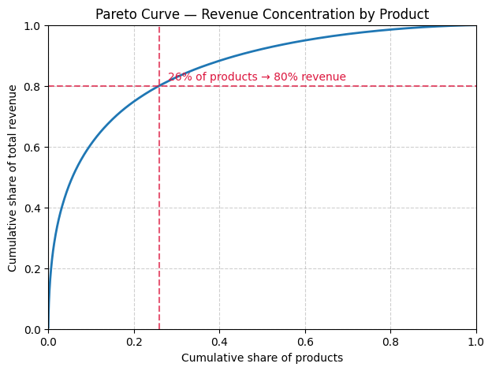
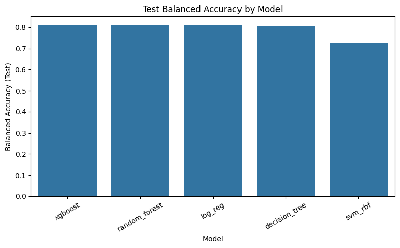
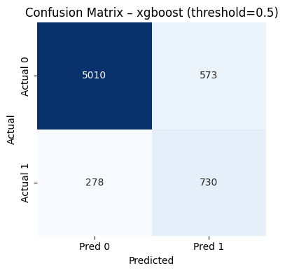

# E-commerce Bestseller Prediction: Early Momentum Forecasting

**Commercial analytics | Python | Supervised machine learning**

## Research question

**Why it matters:** A small share of marketplace products generates most revenue. Identifying promising products early can help merchandising teams prioritize promotion, inventory and fulfillment before demand fully develops.

**Business question:** Can sales signals from the first 7–14 days predict which products will become bestsellers within 60 days of their first recorded purchase?

## Data and methodology

This academic team project uses the Olist Brazilian E-commerce Public Dataset (2016–2018), with 113,314 merged transaction-level records and 32,951 unique products. A bestseller is defined using the 90th percentile of 60-day unit sales; ties produce a positive class of approximately 15.3%.

- Integrated order, item, review and product information and constructed product-level sales windows.
- Used early unit sales, price, freight, delivery time, category, seller and order status in the modeling pipeline.
- Applied a stratified 80/20 product-level split (26,360 training and 6,591 test products), preprocessing pipelines and five-fold cross-validation with grid search.
- Compared logistic regression, decision tree, random forest, RBF SVM and XGBoost using balanced accuracy to account for class imbalance.

## Key findings

Approximately 26% of products generated 80% of observed revenue, motivating early identification of high-potential products.

XGBoost achieved the highest reported test balanced accuracy (0.811), while logistic regression achieved a slightly higher ROC-AUC (0.874 versus 0.871).

| XGBoost test metric (threshold 0.50) | Value |
| --- | ---: |
| Balanced accuracy | 0.811 |
| ROC-AUC | 0.871 |
| Average precision | 0.750 |
| Precision | 0.560 |
| Recall | 0.724 |
| F1 | 0.632 |

The model identified 730 of 1,008 actual bestsellers while flagging 573 non-bestsellers.

## Business implications and limitations

Marketplace teams could use predicted probabilities to prioritize campaigns, stock planning and product monitoring. Thresholds should reflect the cost of missed opportunities versus unnecessary promotion.

This is a retrospective experiment, not a deployed forecasting system. Delivery time and order status may not be known within the intended prediction window; they require a timestamp-based availability audit. A chronological holdout and complete 60-day observation windows should also be validated before operational use. Momentum ratios using 60-day sales are retrospective segmentation measures, not launch-time predictors.

## Explore the analysis

[Project notebook](B09_Early_Momentum_Forecasting.ipynb) · [Olist dataset](https://www.kaggle.com/datasets/olistbr/brazilian-ecommerce/data)

Tools: pandas, NumPy, scikit-learn, XGBoost, Matplotlib, Seaborn.
